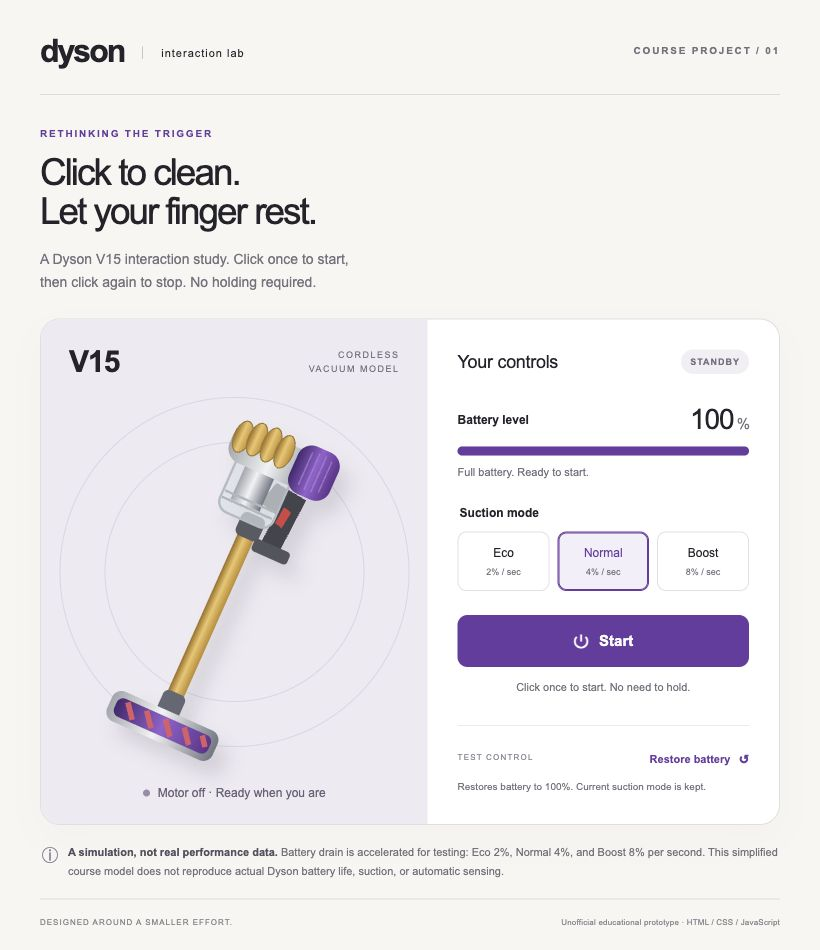

# Dyson V15 Interaction Model

A course prototype exploring click-to-start and click-to-stop controls for a cordless vacuum. The design responds to the student's concern that continuously holding a trigger is tiring for their finger.

## Run locally

Download the project, keep the files together, and open `index.html` in a browser. No installation or build step is required.

## Files

- `index.html` — English interface and vacuum illustration.
- `styles.css` — Layout, visual states, and animation.
- `script.js` — Variables, event handlers, conditions, and battery timer.
- `assignment-description.md` — Design explanation, student-reported tests, contributions, and personal reflection.
- `preview.jpg` — Screenshot of the initial interface.

## Test the interaction

1. Click **Start** and release: the model keeps running, shows running feedback, and the button becomes **Stop**.
2. Click **Stop**: the model stops and battery level stops decreasing.
3. Try **Eco**, **Normal**, and **Boost**: battery drains at different rates.
4. Restore the battery, select **Boost**, and start. After about 13 seconds, the model stops at 0%.
5. Click **Start** at 0%: a message explains why it cannot start.
6. Click **Restore battery**, then **Start**: the model can run again.

Restore battery sets charge to 100% and keeps the mode and current running/stopped condition. Reloading the page resets the model to standby, 100% battery, and Normal mode.

## Simulation limits

Battery drain is accelerated and invented: Eco uses 2 percentage points per second, Normal 4, and Boost 8. These are not real Dyson performance figures. The project is an unofficial educational model and does not simulate real suction physics or automatic sensing.

## Contributions

The student chose the appliance and interaction change, specified the requirements, manually tested the model, and supplied feedback and reflection. An AI assistant helped plan the logic, generated the HTML/CSS/JavaScript and visual design, checked implementation behavior, and drafted documentation based on the student's statements. See `assignment-description.md` for details.

## Submission links

- GitHub repository: [dyson-v15-interaction-model](https://github.com/Yang-Chen66/dyson-v15-interaction-model)
- AI conversation: [View AI conversation](https://chatgpt.com/s/cx_6af2538d3e208191b00dad144fa14136)

